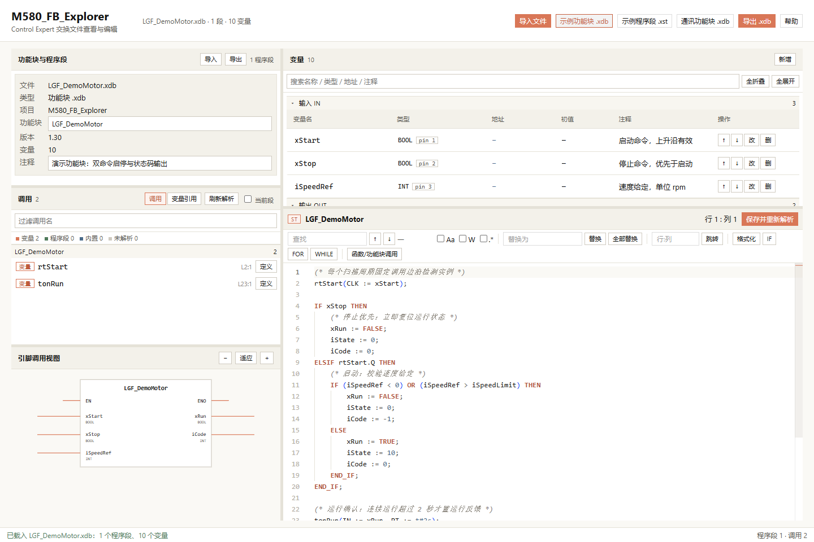
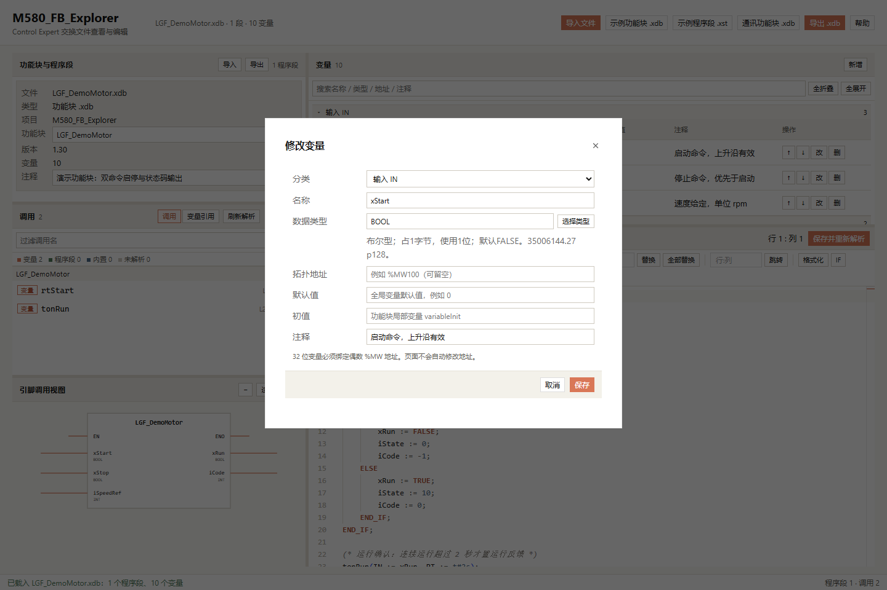
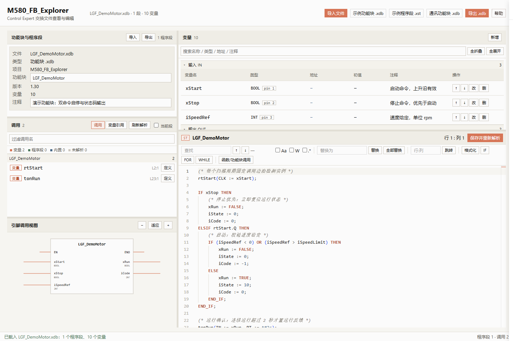
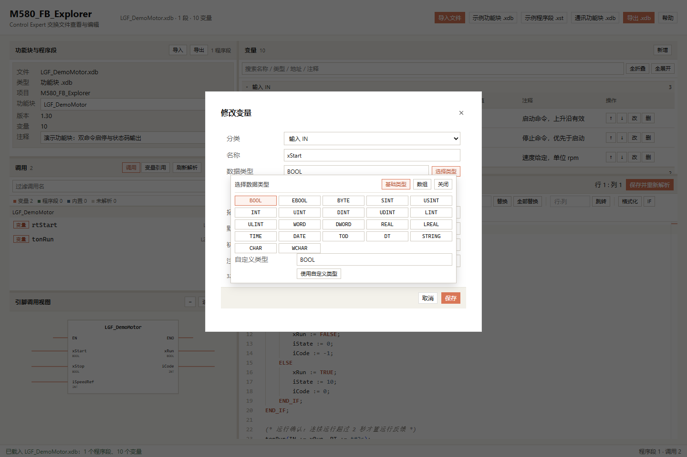
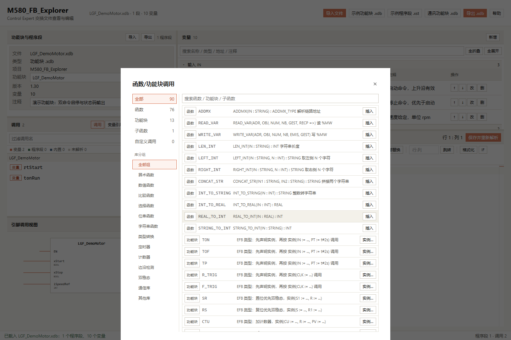

# M580_FB_Explorer

A browser-based viewer and editor for Schneider M580 Control Expert exchange files.

[简体中文](README.md)

## Features

- Import `.xdb`, `.xst`, and `.xsy` files.
- Parse function-block metadata, variables, and program sections.
- Manage `IN`, `OUT`, `IN_OUT`, `PUBLIC`, `PRIVATE`, and `GLOBAL` variables.
- Search, collapse, add, edit, delete, and reorder variables.
- Edit ST program sections with Monaco Editor.
- Search, replace, format, jump, insert templates, and use completion in ST.
- Extract function calls, function-block instance calls, and unknown calls.
- Display a function-block pin diagram.
- Export `.xdb` files.
- Provide a help drawer and a local MCP Bridge stub.
- Select elementary, custom, and array types with the type picker.
- Show variable types and addresses in separate columns with sticky group headings.
- Insert calls from a two-column function browser backed by JSON library and type files.
- Link source positions, variable references, variable rows, and function-block pins.

Saving and reparsing clears the section's unsaved marker. The document remains modified until export.

Library data is in `src/data/functionLibraries/`. See [Contributing](CONTRIBUTE.md#function-library-and-editor-call-maintenance) for maintenance steps. The legacy snapshot is not a complete official manual.

## Interface

### Workspace

The workspace combines function-block metadata, call analysis, the pin diagram, the variable table, and the ST editor.



The left side shows file metadata, program calls, and the pin diagram. The right side shows variables and the program editor. Split bars support dragging, double-click reset, and keyboard resizing.

### Variable editor

The variable editor provides fields for the name, type, address, default value, initial value, and comment.



The application checks variable names, duplicates, categories, and address constraints before saving. It does not overwrite the original file.

### Help and MCP

The help drawer documents file formats, editor actions, export rules, and MCP Bridge tools.



The MCP Bridge exposes local calls for the current page. The application does not connect to a remote service by default.

## Quick start

Use Node.js `22.12` or a later supported version.

```powershell
npm ci
npm run dev
```

Open the HTTP address shown in the terminal. Do not open the application with `file://`.

## Check and build

```powershell
npm run typecheck
npm test
npm run build
npm run test:e2e
```

The build output is written to `dist/`. Deploy the complete `dist/` directory. The build has no external CDN dependency and supports deployment under a subpath.

On Windows, browser tests use Microsoft Edge by default. On other platforms, run:

```powershell
npx playwright install chromium
```

## Type selection and call insertion

The type picker supports elementary, custom, and array types.



The editor toolbar and context menu provide the call browser, with library groups, search, and FB instance selection.



## GitHub Pages

The GitHub Actions workflow runs the type check, unit tests, and production build after every push.

After all checks pass, the workflow publishes `dist/` to GitHub Pages.

Site URL: <https://lilixxs.github.io/M580_FB_Explorer/>

## Screenshots

The bundled demo function block generates the screenshots. The screenshots do not contain user files.

Regenerate the screenshots with:

```powershell
npm run build
npm run docs:screenshots
```

## Data and security boundaries

- The application parses files in the browser.
- The application does not upload imported files.
- The application does not connect to a PLC.
- The `.xdb` sample snapshot is stored at `fixtures/ModbusTCP_Client.xdb`.
- The repository does not commit `dist/`, test results, editor settings, keys, local environment files, or local AI-tool files.

## Known boundaries

- Control Expert import and compilation were not executed.
- Real PLC communication tests were not executed.
- XML structure validation does not prove Control Expert import compatibility.
- When `.xst` or `.xsy` is exported as `.xdb`, `GLOBAL` variables become `.xdb` private variables and a conversion warning is shown.

## Documentation

- [Contribution guide](CONTRIBUTE.md)
- [Feature requirements](docs/requirements.md)
- [Bundled help content](src/data/helpContent.ts)

## License

This repository does not currently declare an open-source license. Do not use the code for production distribution unless the repository owner grants permission.
