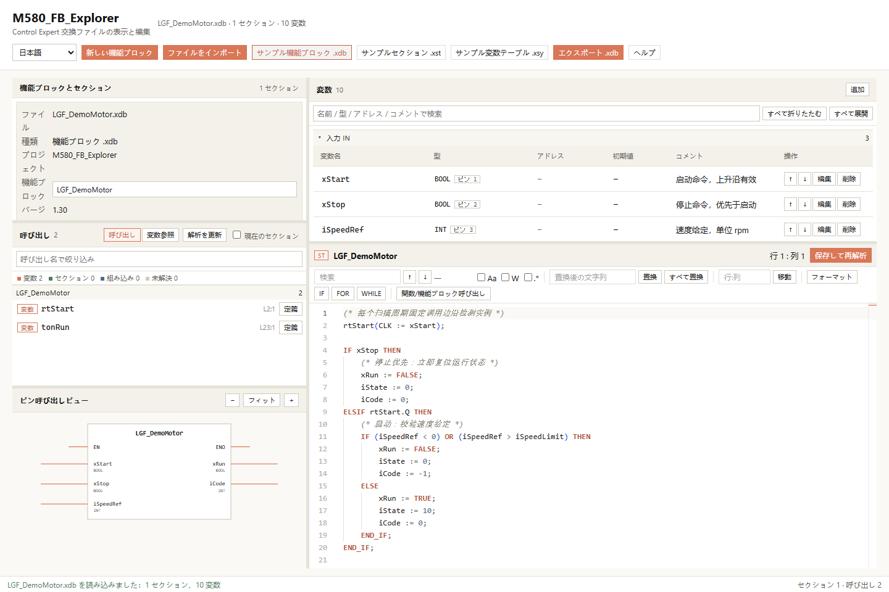
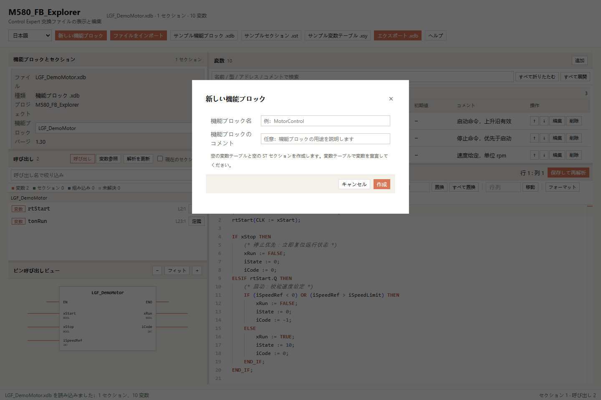
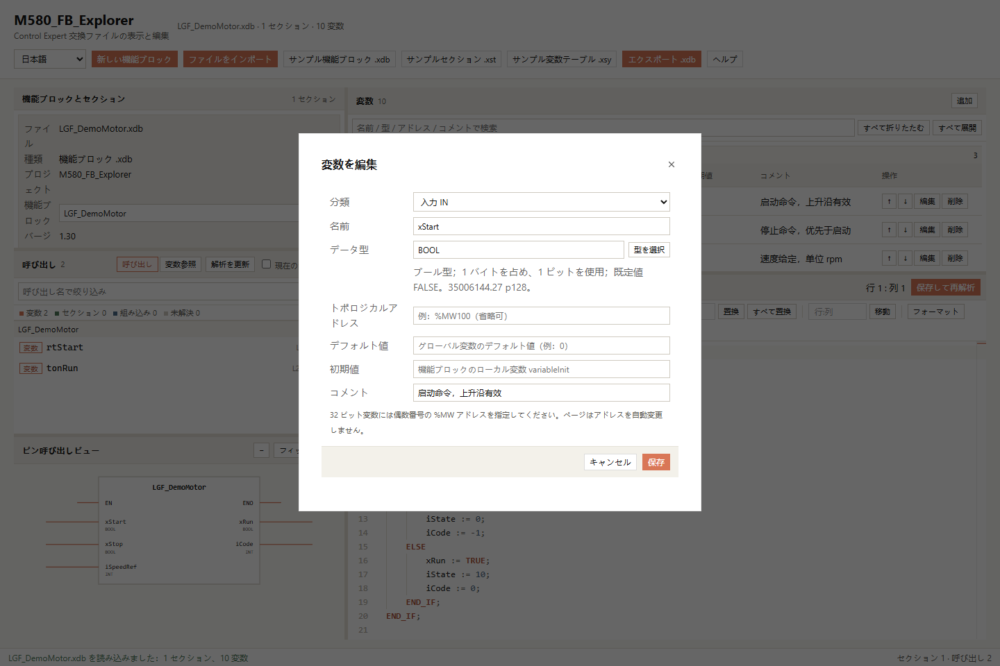
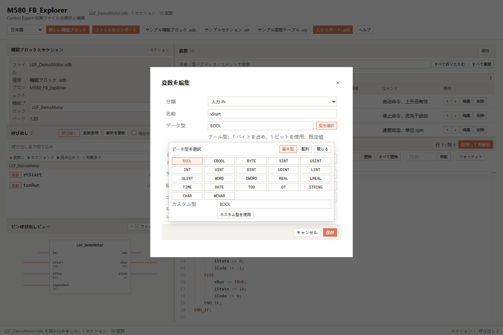
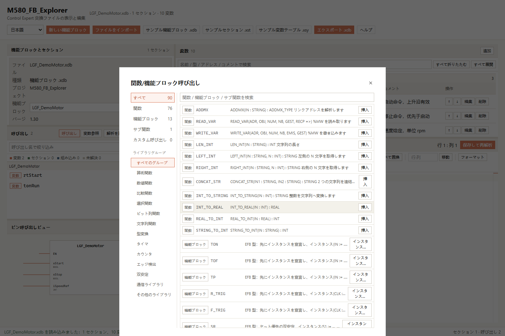

# M580_FB_Explorer

[简体中文](README.md) | [English](README.en.md) | [繁體中文](README.zh-TW.md) | [日本語](README.ja.md) | [한국어](README.ko.md)

Schneider M580 Control Expert の交換ファイルをブラウザーで表示、編集するツールです。この README を画面内ヘルプの唯一の本文として使用します。

アプリを開く：<https://lilixxs.github.io/M580_FB_Explorer/>

このページはブラウザー上で Control Expert の交換ファイルを解析します。インポートしたファイルをアップロードしません。PLC に接続しません。

本書のスクリーンショットは内蔵サンプルのみを使用します。

## 1. インターフェース言語

上部バーに言語切り替えの項目があります。簡体字中国語、英語、繁体字中国語、日本語、韓国語から選べます。

ブラウザーがローカルストレージを許可しているとき、ページは言語選択を記憶します。

言語を切り替えても、ドキュメント、ソースコード、未エクスポートの変更は消えません。

インターフェースの表示とメッセージは選択した言語を使用します。PLC 識別子、ユーザー ファイルの内容、XML 形式の値はインターフェース言語によって変わりません。

既存のステータスメッセージと解析警告は、生成時の言語を保持します。以降の操作は新しく選択した言語を使用します。

## 2. ファイルのインポート



上部バーの「ファイルをインポート」をクリックして、.xdb、.xst、.xsy ファイルを選択します。ファイルをウィンドウにドラッグすることもできます。

上部バーのサンプル ボタンをクリックすると、内蔵サンプルを読み込みます。

インポートとエクスポートのボタンは上部バーにのみあります。左上パネルにはインポートとエクスポートのボタンがありません。

左上の領域にはファイル情報、セクション一覧、解析警告の項目が表示されます。

セクションをクリックすると、右下のエディターに該当の内容が表示されます。

同時に編集できるドキュメントは 1 つだけです。再インポートすると現在のドキュメントは置き換えられます。変更後のファイルを先にエクスポートしてください。

インポートに成功すると、ページは検索語と折りたたみ状態を消去します。

ページは、単一 FBSource の .xdb ファイル、セクションの .xst ファイル、変数テーブルの .xsy ファイルに対応します。複数の機能ブロック スコープはまだ統合されません。安全に処理できない構造はインポートを拒否し、理由を表示します。

ST 以外のセクションは読み取り専用の XML 原文を表示します。ページは図言語を ST に変換しません。

## 3. 機能ブロックの新規作成



上部バーの「新しい機能ブロック」をクリックすると、ダイアログが開きます。

ダイアログで機能ブロック名を入力します。コメントも入力できます。

名前はこのプロジェクトの IEC 識別子規則に従わなければなりません。

確認すると、ページは空の変数テーブルと空の ST セクションを 1 つ作成します。

現在のドキュメントに未エクスポートの変更があるとき、ページは置き換えの前に確認を求めます。

新しいドキュメントは、既存の変数編集、ST 編集、保存、.xdb エクスポートの手順を使用します。

## 4. メタ情報の編集

機能ブロック名とコメントは下書き編集を使用します。

新しい値を入力したあと、「確認」をクリックすると初めてドキュメントに書き込まれます。

「キャンセル」をクリックすると元の値に戻ります。

未確認の下書きがある場合、パネルに「メタ情報の下書きがまだ確認されていません」と表示します。

## 5. レイアウトとピン ビュー

左と右のカラムは既定で 34% と 66% です。右上の変数一覧は既定で高さの 1/3、右下のセクション エディターは既定で高さの 2/3 です。

左カラムには順にメタ情報、呼び出し一覧、ピン呼び出しビューが表示されます。区切り線をドラッグするとパネルのサイズを変更できます。区切り線をダブルクリックするとサイズがリセットされます。区切り線にフォーカスしてから矢印キーで細かく調整できます。

ページは狭い画面では縦配置に切り替わります。パネル内の表は横スクロールに対応します。ブラウザーがローカルストレージを許可しているとき、ページはパネル サイズを記録します。

ピン ビューは IN、OUT、IN_OUT を表示します。IN_OUT は破線で識別します。PRIVATE、PUBLIC、GLOBAL はピンとして描画しません。EN と ENO はシステム ピンの記号にすぎません。ピンをクリックすると右上の変数を特定します。

ピン パネルの加減ボタンでビューを拡大縮小できます。ピンをクリックすると、ページは変数の検索語を消去し、対応するグループを展開します。

ピンまたは変数行をクリックすると、エディターはその変数の使用箇所を特定します。呼び出しパネルは関連する変数参照を表示します。参照のない変数は無関係なジャンプを引き起こしません。

## 6. 変数の管理



変数は IN、OUT、IN_OUT、PUBLIC、PRIVATE、GLOBAL ごとにグループ化します。GLOBAL は dataBlock のグローバル変数に対応します。

検索ボックスに変数名、型、アドレス、初期値、コメントを入力します。検索時に一致するグループが自動的に展開されます。グループ見出しをクリックすると、グループを折りたたみます。

「追加」をクリックすると変数を作成します。「編集」をクリックすると変数を変更します。「削除」をクリックして確認すると変数を削除します。上下矢印で同じ種類の変数の順序を変更します。ピン番号 PositionPin は順に再計算されます。



「型を選択」をクリックすると基本型を選択できます。カスタム型を入力することもできます。配列モードは要素型、下限、上限を提供します。結果は ARRAY[下限..上限] OF 型 の形式を使用します。

変数テーブルには型とアドレスを別々に表示します。変数テーブルをスクロールすると、現在のグループ見出しが表の先頭に固定されます。

変数名は先頭を英字またはアンダースコアにしなければなりません。残りの文字は英字、数字、アンダースコアのみです。変数名は大文字小文字を区別せず重複してはなりません。EN と ENO は通常のピンとして追加できません。

32 ビット型の %MW アドレスは偶数にしてください。現在のエクスポーターは、接尾辞のない奇数の %MW アドレスを次の偶数に変更し、警告を表示します。マッピングの変更を避けるため、先に変数ダイアログでアドレスを確認してください。

## 7. ST 呼び出しの解析



左中の一覧には関数と機能ブロックの呼び出しが表示されます。一覧は未知の呼び出しを保持し、未知の名前をシステム関数と見なしません。パーサーは文字列とコメント内の見かけの呼び出しを無視します。

呼び出し項目をクリックすると、エディターは該当の行と列にジャンプします。「解析を更新」をクリックするとコードを再解析します。セクションの保存でも呼び出し一覧は更新されます。

呼び出しパネルは通常の変数参照も提供します。参照解析はコメント、文字列、名前付き実引数の形式パラメータ名を無視します。参照をクリックすると、コード、変数行、対応するピンを同時に特定します。エディターで変数をクリックすると選択状態も更新されます。

呼び出し解析は構文コンパイルではありません。ページはすべての関数シグネチャを検査せず、ST コードを実行しません。

## 8. エディター操作

| 操作 | 入口 |
| --- | --- |
| 検索 | Ctrl+F、ツールバー、右クリック メニュー |
| 置換 | Ctrl+H、ツールバー、右クリック メニュー |
| 行:列への移動 | Ctrl+G または 行:列 入力欄 |
| 整形 | Shift+Alt+F、ツールバー、右クリック メニュー |
| IF / FOR / WHILE の挿入 | ツールバー、右クリック メニュー |
| 関数/機能ブロック呼び出し | ツールバー、右クリック メニュー |
| 保存と解析 | Ctrl+S または保存ボタン |
| 自動補完 | 入力時、または Ctrl+Space |

自動補完にはキーワード、現在の変数、よく使う関数、文テンプレートが含まれます。整形プログラムは対応済みの ST 構造のみを整理します。完全な IEC 61131-3 コンパイラの代わりにはなりません。

エディターの保存はページ メモリに書き込むだけです。保存はディスク上の元ファイルを変更しません。変更後のファイルをダウンロードするには、上部バーの「エクスポート .xdb」をクリックしてください。

保存して再解析すると、現在のセクションの「未保存」表示は消えます。上部バーの「変更あり」はまだエクスポートしていないことを示します。セクションの保存では消えません。

「関数/機能ブロック呼び出し」ダイアログは分類欄と項目欄で構成されます。ダイアログは検索、関数、機能ブロック、現在のドキュメントのセクション、カスタム呼び出しに対応します。挿入位置はダイアログを開いたときのエディターの選択範囲またはカーソルです。

EFB はインスタンスを使用しなければなりません。同じ種類の既存インスタンスを選択するか、新しいインスタンス名を入力して PRIVATE 変数の作成を確認してから挿入します。挿入後はパラメータと呼び出し位置を確認してください。セクション名の呼び出しはすべてのタスク コンテキストへの適合を保証しません。

関数と変数型のデータは src/data/functionLibraries/ 以下の JSON から取得します。ベース スナップショットは公式マニュアルの完全版ではありません。各ライブラリは出所と範囲を明記します。保守方法は[英語の貢献ガイド](CONTRIBUTING.en.md)を参照してください。JSON を変更した後は再ビルドが必要です。

Standard ライブラリの資料は 33002519.20（09/2020、Control Expert 15.0 以上向け）に由来します。カタログは別途保存しています。呼び出し一覧は検証済みの具体的な関数のみを含みます。変数型の説明は 35006144.27 に由来します。旧プリセットの拡張型は M580 対応が検証済みであることを意味しません。Unity Pro V13.1 との互換性は未検証です。

Monaco の読み込みに失敗すると、ページはエラーを表示してテキスト ボックスに切り替えます。テキスト ボックスは構文ハイライトと自動補完を提供しません。

## 9. エクスポート規則

エクスポーターはプロジェクトの XML 規則に従います。規則の出所は開発ワークスペース AGENTS.md の第 4 節です。リポジトリ内の制約は[機能要件](docs/requirements.md)を参照してください。

- STSource は実行可能文のみを許可します。現在のエクスポーターは VAR 宣言領域を削除し、警告を表示します。削除しても変数は自動作成しません。宣言の消失を避けるため、先に変数テーブルへ追加してください。
- 入力、出力、双方向のパラメータは対応するコンテナに書き込みます。PositionPin は 1 から増加します。
- 機能ブロックの初期値は variableInit に書き込みます。グローバル変数の初期値は defaultValue から読み込みます。
- 空の topologicalAddress と空の comment は省略されます。
- エクスポーターは自己クローズ タグを展開します。
- 32 ビットの %MW 変数は偶数アドレスにしてください。現在のエクスポーターは接尾辞のない奇数アドレスを偶数に変更して警告を表示します。この理由でエクスポートを拒否しません。
- .xdb の書き戻しでは、編集していない拡張ノードと属性を保持します。

.xst または .xsy から .xdb へのエクスポートは構造変換です。GLOBAL 変数は PRIVATE に変換されます。ページは変換警告を表示します。セクションのタスク コンテキストが PLC タスクになることはありません。変換結果を確認してください。

エクスポートに警告が含まれるとき、ページは「エクスポートの説明」ドロワーに警告全文を表示します。

Control Expert でのインポート、コンパイル、実機通信テストはいずれも未実施です。

アドレスの自動変更と宣言の削除は現在の実装の動作です。エクスポートを拒否する要件は満たしていません。警告と出力 XML を確認してください。実装との差異は[機能要件](docs/requirements.md)を参照してください。

## 10. MCP 予約インターフェース

ページは window.__M580_MCP_BRIDGE__ を提供します。ブリッジは listTools()、callTool(name, input)、getState() を提供します。

これはページ内ツール インターフェースであり、独立した MCP サーバーではありません。ページは既定でリモート サービスに接続しません。トランスポート アダプターは接続境界を提供するだけです。

| ツール | 用途 |
| --- | --- |
| m580_fb_get_metadata | ドキュメントの概要を読み取る |
| m580_fb_list_variables | category と search で変数を問い合わせる |
| m580_fb_upsert_variable | id で変数を変更するか、変数を追加する |
| m580_fb_delete_variable | id で変数を削除する |
| m580_fb_get_source | sectionId でコードを読み取る |
| m580_fb_set_source | source を書き込んで呼び出しを解析する |
| m580_fb_insert_snippet | line、column の位置に source または kind テンプレートを挿入する |
| m580_fb_analyze_calls | 呼び出しを再抽出する |

互換ツールとして以下を保持します：m580_get_state、m580_import、m580_list_variables、m580_upsert_variable、m580_delete_variable、m580_get_section、m580_set_section_source、m580_save_section、m580_format_section、m580_replace_in_section、m580_extract_calls、m580_export_xdb、m580_get_help、m580_jump。

各ツールのフィールドと必須パラメータは、listTools() が返す inputSchema で確認してください。callTool() は ok、result、error を返します。

例：

```js
await window.__M580_MCP_BRIDGE__.callTool('m580_fb_list_variables', { category: 'IN' })
```

## 11. デプロイと更新

npm run build を実行した後、dist/ 全体を静的ファイル サーバーにコピーします。サブ パスへのデプロイに対応します。file:// で直接開かないでください。Monaco ワーカーは HTTP または HTTPS で読み込む必要があります。

ビルド成果物にはページ、スタイル、スクリプト、ワーカーが含まれます。ビルド成果物は外部 CDN に依存しません。

ヘルプ本文の原本はルート ディレクトリの 5 言語の README のみです。アプリは選択した README を Vite の raw インポートで読み込みます。ビルドは 5 言語の README、2 つの貢献ガイド、docs/requirements.md の名前と docs/images/<言語>/ の画像パスを保持します。別のヘルプ本文を作成しないでください。

冒頭の言語リンクは相対パスを使用します。GitHub では対応する README を開きます。画面内ヘルプでは画面言語とヘルプ本文を切り替えます。編集中のドキュメントは置き換えません。

機能を変更したら、5 言語の README と docs/requirements.md を更新してください。納品前に型チェック、単体テスト、ビルド、ブラウザー テストを再実行してください。

## 12. ローカル開発とチェック

Node.js 22.12 以降のサポート対象バージョンを使用してください。

```powershell
npm ci
npm run dev
```

ターミナルに表示された HTTP アドレスを開きます。コミット前に次のコマンドを実行してください。

```powershell
npm run typecheck
npm test
npm run build
npm run test:e2e
node scripts/check-localized-docs.mjs
```

Windows のブラウザー テストは既定で Microsoft Edge を使用します。他の環境では先に `npx playwright install chromium` を実行してください。

画面の変更が画像に影響する場合は、次の順に実行してください。

```powershell
npm run build
npm run docs:screenshots
npm run build
node scripts/check-localized-docs.mjs
```

画像は内蔵サンプルのみを使用します。各 README は同じ言語の 5 枚の画像だけを参照します。

任意のブランチへのプッシュ後、GitHub Actions は型チェック、単体テスト、ビルド、文書チェックを実行します。チェックが通ると dist/ を GitHub Pages に公開します。

## 13. 貢献と制約

- [中国語の貢献ガイド](CONTRIBUTING.md)
- [English contribution guide](CONTRIBUTING.en.md)
- [機能要件](docs/requirements.md)

サンプルは fixtures/ModbusTCP_Client.xdb にあります。ユーザー ファイル、秘密情報、ローカル環境ファイル、node_modules/、dist/、テスト結果、AI ツールのローカル ファイルをコミットしないでください。

XML 構造の検査は Control Expert へのインポート成功を証明しません。Control Expert でのインポート、コンパイル、PLC 実機通信テストは未実施です。

## 14. ライセンス

このリポジトリはオープンソース ライセンスを宣言していません。所有者の許可なしに本番配布でコードを使用しないでください。
